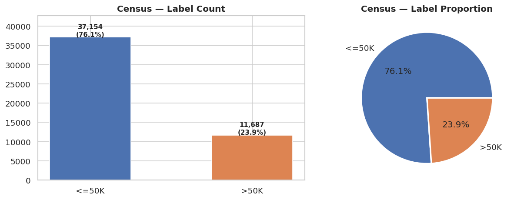
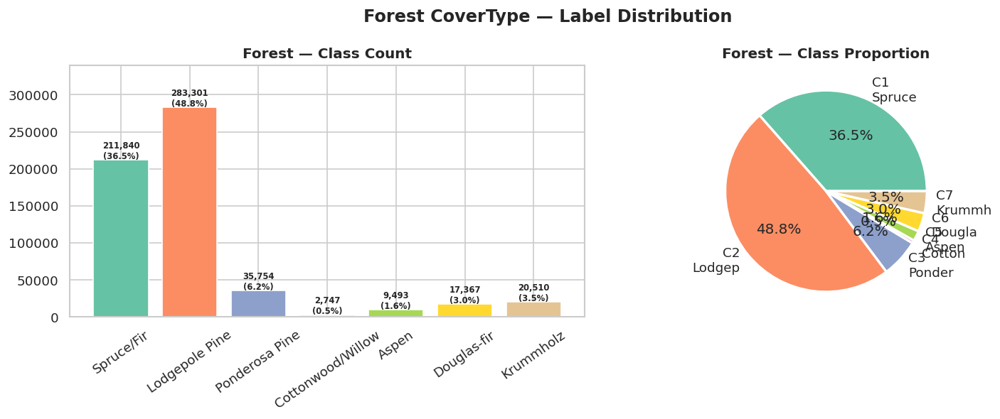

# Datasets

This folder holds the two cleaned CSV files used by the notebook (`../source/feature_unlearning_gbt_source.ipynb`),
together with a descriptive analysis of each dataset. Both are derived from public UCI datasets.

| File | Source | Rows x columns | Task | Size |
|---|---|---|---|---|
| `census_stable.csv` | [Adult / Census Income](https://archive.ics.uci.edu/dataset/2/adult) | 48,841 x 15 | Binary classification (income `<=50K` / `>50K`) | ~5.7 MB |
| `covtype_stable.csv` | [Covertype](https://archive.ics.uci.edu/dataset/31/covertype) | 581,012 x 11 | 7-class classification (forest cover type) | ~24 MB |

If a file is missing, download it from Google Drive (the same files the notebook fetches with `gdown`):

```bash
# run from the repository root
mkdir -p dataset
gdown 1BrR9UMFox4-DKYt4g3gYc8hDQTAwwnO2 -O dataset/census_stable.csv    # https://drive.google.com/uc?id=1BrR9UMFox4-DKYt4g3gYc8hDQTAwwnO2
gdown 1aE4163bJluyY9Y95X551Ggc6foC8rdXW -O dataset/covtype_stable.csv   # https://drive.google.com/uc?id=1aE4163bJluyY9Y95X551Ggc6foC8rdXW
```

> The statistics below describe the **original, unbalanced** files (notebook Part 1). Class balancing and drift
> injection (Parts 1b and 2) are applied later, inside the notebook, and do not modify these CSVs.

---

## 1. Census Income (Adult)

Predicts whether a person earns **more than $50K per year** from demographic attributes.

### Schema

| Feature group | Columns |
|---|---|
| **Numerical (6)** | `age`, `fnlwgt`, `education-num`, `capital-gain`, `capital-loss`, `hours-per-week` |
| **Categorical (8)** | `workclass`, `education`, `marital-status`, `occupation`, `relationship`, `race`, `sex`, `native-country` |
| **Label** | `label` ∈ {`<=50K` (0), `>50K` (1)} |

After one-hot encoding, the 14 attributes expand to a **108-dimensional** feature matrix (used by the drift-score
step and the models).

### Numerical features

| Feature | Mean | Std | Min | 25% | Median | 75% | Max |
|---|---|---|---|---|---|---|---|
| `age` | 38.64 | 13.71 | 17 | 28 | 37 | 48 | 90 |
| `fnlwgt` | 189,663.37 | 105,604.97 | 12,285 | 117,549 | 178,142 | 237,646 | 1,490,400 |
| `education-num` | 10.08 | 2.57 | 1 | 9 | 10 | 12 | 16 |
| `capital-gain` | 1,079.09 | 7,452.09 | 0 | 0 | 0 | 0 | 99,999 |
| `capital-loss` | 87.50 | 403.01 | 0 | 0 | 0 | 0 | 4,356 |
| `hours-per-week` | 40.42 | 12.39 | 1 | 40 | 40 | 45 | 99 |

`capital-gain` and `capital-loss` are extremely sparse: 91.7 % and 95.3 % of the rows are exactly 0, with a few very
large values (up to 99,999). This heavy skew is worth keeping in mind because `capital-gain` is the feature that the
drift score identifies as stale (paper, Fig. 1).

### Categorical features

| Feature | # categories | `?` (missing) | Most frequent value |
|---|---|---|---|
| `workclass` | 9 | 2,799 | Private (69.4 %) |
| `education` | 16 | 0 | HS-grad (32.3 %) |
| `marital-status` | 7 | 0 | Married-civ-spouse (45.8 %) |
| `occupation` | 15 | 2,809 | Prof-specialty (12.6 %) |
| `relationship` | 6 | 0 | Husband (40.4 %) |
| `race` | 5 | 0 | White (85.5 %) |
| `sex` | 2 | 0 | Male (66.8 %) |
| `native-country` | 42 | 857 | United-States (89.7 %) |

**Missing values.** There are no empty cells, but missing information is coded as the string `"?"` in three columns
(6,465 cells in total). The notebook keeps `?` as its own category (e.g. `workclass_?`) instead of imputing it.

### Label distribution

| Class | Count | Share |
|---|---|---|
| `<=50K` | 37,154 | 76.07 % |
| `>50K` | 11,687 | 23.93 % |

Imbalance ratio: **3.18 : 1** (mild). A majority-class predictor already reaches ~76 % accuracy, so F1 and AUC are
reported alongside accuracy. SMOTE is applied once, before drift generation, giving a balanced pool of 74,308 rows
(37,154 per class, 108 features).



---

## 2. Forest Cover Type

Predicts the **forest cover type** of each 30 m x 30 m cell in a Colorado forest from cartographic and hydrological
attributes.

### Schema

| Feature | Description |
|---|---|
| `Elevation` | Elevation in meters |
| `Aspect` | Aspect in degrees azimuth |
| `Slope` | Slope in degrees |
| `Horizontal_Distance_To_Hydrology` | Horizontal distance to nearest surface water |
| `Vertical_Distance_To_Hydrology` | Vertical distance to nearest surface water |
| `Horizontal_Distance_To_Roadways` | Horizontal distance to nearest roadway |
| `Hillshade_9am`, `Hillshade_Noon`, `Hillshade_3pm` | Hillshade index (0-255) at 9 am, noon and 3 pm in summer |
| `Horizontal_Distance_To_Fire_Points` | Horizontal distance to nearest wildfire ignition point |
| `label` | Cover type, 1-7 (see below) |

Only the 10 continuous variables are kept (the wilderness-area and soil-type indicators of the original Covertype
data are not used), and no encoding is needed.

### Numerical features

| Feature | Mean | Std | Min | 25% | Median | 75% | Max |
|---|---|---|---|---|---|---|---|
| `Elevation` | 2,959.37 | 279.98 | 1,859 | 2,809 | 2,996 | 3,163 | 3,858 |
| `Aspect` | 155.66 | 111.91 | 0 | 58 | 127 | 260 | 360 |
| `Slope` | 14.10 | 7.49 | 0 | 9 | 13 | 18 | 66 |
| `Horizontal_Distance_To_Hydrology` | 269.43 | 212.55 | 0 | 108 | 218 | 384 | 1,397 |
| `Vertical_Distance_To_Hydrology` | 46.42 | 58.30 | -173 | 7 | 30 | 69 | 601 |
| `Horizontal_Distance_To_Roadways` | 2,350.15 | 1,559.25 | 0 | 1,106 | 1,997 | 3,328 | 7,117 |
| `Hillshade_9am` | 212.15 | 26.77 | 0 | 198 | 218 | 231 | 254 |
| `Hillshade_Noon` | 223.32 | 19.77 | 0 | 213 | 226 | 237 | 254 |
| `Hillshade_3pm` | 142.53 | 38.27 | 0 | 119 | 143 | 168 | 254 |
| `Horizontal_Distance_To_Fire_Points` | 1,980.29 | 1,324.20 | 0 | 1,024 | 1,710 | 2,550 | 7,173 |

There are no missing values and no duplicate rows. The three `Hillshade_*` attributes are the stale features
selected in the paper; they are highly collinear with the remaining features, which is why attribute inference on them
stays high for every model, including the Gold Retrain (paper, Sec. 7).

### Label distribution

| Label | Cover type | Terrain characteristics | Count | Share |
|---|---|---|---|---|
| 1 | Spruce/Fir | High elevation, heavily shaded | 211,840 | 36.46 % |
| 2 | Lodgepole Pine | Most common, widely distributed | 283,301 | 48.76 % |
| 3 | Ponderosa Pine | Lower elevation, gentle slope | 35,754 | 6.15 % |
| 4 | Cottonwood/Willow | Near water, very rare | 2,747 | 0.47 % |
| 5 | Aspen | Mid elevation | 9,493 | 1.63 % |
| 6 | Douglas-fir | Steep slope, south-facing | 17,367 | 2.99 % |
| 7 | Krummholz | Very high elevation, exposed to wind | 20,510 | 3.53 % |

Imbalance ratio: **103.1 : 1** (severe). Classes 1 and 2 account for 85 % of the data and class 4 for under 0.5 %.
This matters for unlearning because the minority class must not vanish once the older domains are forgotten, so
random oversampling is applied once, before drift generation, raising every class to the size of the majority class
(283,301 rows). SMOTE is not used here because it would be memory-prohibitive at this scale.



*(In the right-hand pie chart the labels of the smallest classes overlap; the exact counts are in the bar chart and in
the table above.)*

---

## Files in this folder

```
dataset/
├── README.md                  <- this file
├── census_stable.csv
├── covtype_stable.csv
└── figures/
    ├── census_label_dist.png  <- exported from notebook Part 1 (1.1)
    └── forest_label_dist.png  <- exported from notebook Part 1 (1.2)
```
